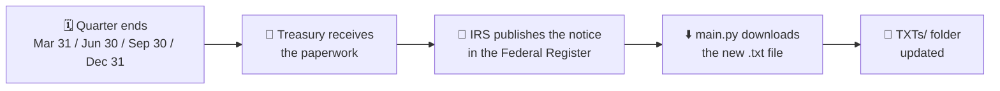
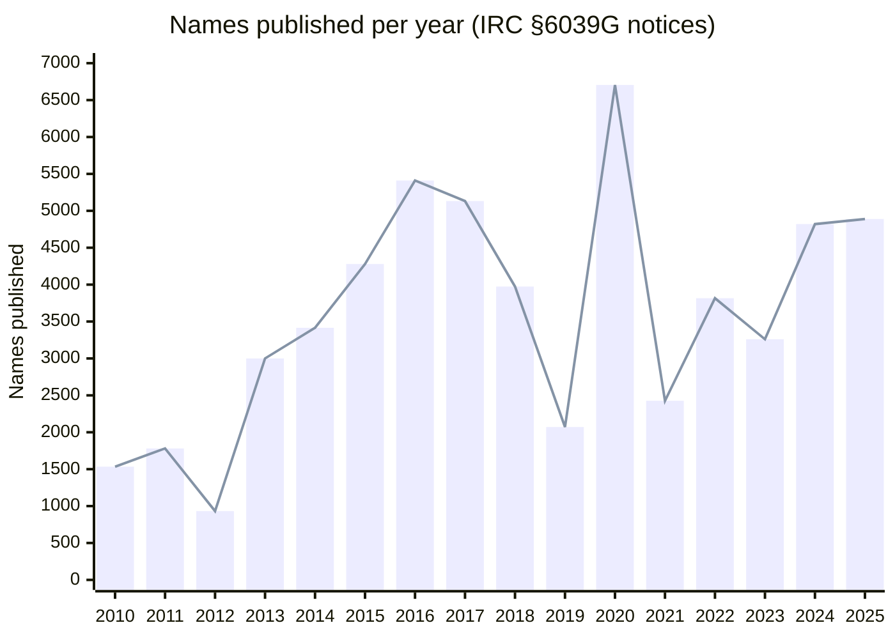
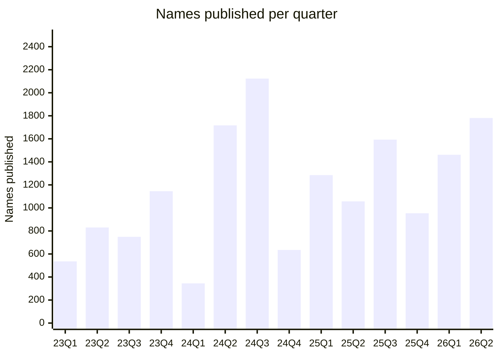

# 🗽 USA Quarterly Expatriation List


> 📬 **Every quarter, the U.S. government publishes the names of people who gave up U.S. citizenship or long-term U.S. residency.**
> This repository collects each of those official notices as plain `.txt` files, so you can search, study and archive them in one place.

---

## 📑 Table of Contents

- [🔎 What is this list?](#-what-is-this-list)
- [📅 Updated quarterly](#-updated-quarterly)
- [📊 The data at a glance](#-the-data-at-a-glance)
- [📂 What is in this repository](#-what-is-in-this-repository)
- [🚀 How to use this list](#-how-to-use-this-list)
- [💡 Benefits of this list](#-benefits-of-this-list)
- [🚧 Limitations: read the numbers carefully](#-limitations-read-the-numbers-carefully)
- [🤝 Responsible use](#-responsible-use)
- [🔄 Keeping the repository fresh](#-keeping-the-repository-fresh)
- [📚 Sources](#-sources)
- [📝 Disclaimer](#-disclaimer)

---

## 🔎 What is this list?

Section **6039G** of the U.S. Internal Revenue Code (26 U.S.C. § 6039G) requires the Treasury Department to publish the name of each individual who loses U.S. citizenship, based on information the government received during the quarter. The Internal Revenue Service (IRS) does this by filing a notice in the **Federal Register** titled _"Quarterly Publication of Individuals, Who Have Chosen To Expatriate"_.

| 📌 Quick fact         | 📖 Detail                                                                                                                                                            |
| --------------------- | -------------------------------------------------------------------------------------------------------------------------------------------------------------------- |
| 🏛️ **Publisher**      | Internal Revenue Service (Treasury Department), in the Federal Register                                                                                              |
| ⚖️ **Legal basis**    | IRC § 6039G (added by the Health Insurance Portability and Accountability Act of 1996)                                                                               |
| 🔁 **Frequency**      | Quarterly (the law sets a 30-day target after each quarter ends)                                                                                                     |
| 👥 **Who is named**   | Former U.S. citizens, and long-term residents who ended their U.S. resident status (they are treated as if they were citizens who lost citizenship for this listing) |
| 🧾 **What is listed** | Names only: no country of residence, age or reason                                                                                                                   |
| 🗓️ **Running since**  | 1996 (first lists appeared in 1997)                                                                                                                                  |

This repository downloads **every notice that the Federal Register returns for a search on `6039G`** and stores it locally as a text file. That includes the quarterly lists and may also include correction notices that the IRS files when it fixes an earlier list.

---

## 📅 Updated quarterly

The IRS publishes a new list **four times a year**, shortly after each calendar quarter ends. This repository follows the same rhythm: **it is refreshed every quarter, once the new notice appears.**



### 📆 Typical publication schedule

| Quarter covered | 🗓️ Quarter ends | 📰 Usually published           |
| --------------- | --------------- | ------------------------------ |
| Q1              | March 31        | Late April                     |
| Q2              | June 30         | Late July                      |
| Q3              | September 30    | Late October to mid-November   |
| Q4              | December 31     | Late January to early February |

Recent real examples: Q4 2025 was published **2026-01-23**, Q1 2026 on **2026-04-22**, Q2 2026 on **2026-07-23**, and a notice on **2026-10-30** (document `2026-22229`) is the one used as the model file for this project.

> ⏱️ **Timing note:** since 2017 the notices have appeared roughly 2.5 to 7 weeks after quarter-end. Because Treasury lists people by when it _received information_, a person can appear in a list long after the actual renunciation date (often months later).

---

## 📊 The data at a glance

All counts below are the **number of names published per quarter**, compiled from the Federal Register notices. They count list entries, which can include duplicates and occasional errors, so treat them as indicators rather than exact head-counts.

### 📈 Names published per year (2010 to 2025)



### 🔬 Zoom in: names per quarter (Q1 2023 to Q2 2026)



### 🧮 Year-by-year table

| 📅 Year      |  👥 Names | 📝 Note                                                                   |
| ------------ | --------: | ------------------------------------------------------------------------- |
| 2010         |     1,534 | Early surge after FATCA became law                                        |
| 2011         |     1,781 |                                                                           |
| 2012         |       932 |                                                                           |
| 2013         |     3,000 |                                                                           |
| 2014         |     3,415 |                                                                           |
| 2015         |     4,279 |                                                                           |
| 2016         |     5,410 | 🏔️ Highest year before 2020                                               |
| 2017         |     5,132 |                                                                           |
| 2018         |     3,974 |                                                                           |
| 2019         |     2,071 | Unusually low (publication backlog)                                       |
| 2020         | **6,705** | 🏆 Highest year on record (backlog catch-up plus pandemic-era processing) |
| 2021         |     2,426 |                                                                           |
| 2022         |     3,816 |                                                                           |
| 2023         |     3,260 |                                                                           |
| 2024         |     4,820 | Q3 2024 alone listed 2,123 names                                          |
| 2025         |     4,889 | About +1.4% versus 2024                                                   |
| 2026 (to Q2) |     3,243 | Q1: 1,462 and Q2: 1,781 (Q2 was reported as +68.5% versus Q2 2025)        |

> 🧪 **Where the numbers come from:** the per-quarter counts are taken from a public compilation of the Federal Register notices (see [Sources](#-sources)). Other trackers sometimes show slightly different yearly totals. For exact figures, count the entries yourself in the `.txt` files in this repository.
>
> 🆕 Reports on the latest 2026 notices put the total for the first three quarters of 2026 at about **4,574 names**, which would make Q3 2026 about 1,331. Please verify that quarter against the newest file in `TXTs/`.

### 🔭 What the data suggests

- 📉➡️📈 **Volumes swing a lot.** The list reflects when paperwork reached Treasury, so backlogs and slow periods create spikes and dips (note 2019 versus 2020).
- 🌍 **Several forces are often cited for the long-term rise:** FATCA reporting rules (2010 onward), the cost of U.S. tax compliance abroad, and changes in consular processing.
- 💵 **2026 is running hot.** News coverage linked part of the 2026 increase to a cut in the State Department renunciation fee (reported as falling from $2,350 to $450 in April 2026), though the timing lag makes cause and effect hard to prove.

---

## 📂 What is in this repository

```text
usa-quarterly-expatriation-list/
├── 📄 README.md                    ← you are here
├── 🐍 main.py                      ← the downloader (Python standard library only)
└── 📁 TXTs/                        ← one text file per Federal Register notice
    ├── 2026-10-30_2026-22229.txt
    ├── …
    └── (new files appear each quarter)
```

📌 **File naming:** `YYYY-MM-DD_<federal-register-document-number>.txt`. The date is the publication date, so the folder sorts chronologically. For example, `2026-10-30_2026-22229.txt` is document `2026-22229`, published October 30, 2026.

---

## 🚀 How to use this list

### 👀 1. Browse and search (no setup needed)

Open any file in the `TXTs/` folder on GitHub. To search every notice at once from a terminal:

```bash
# 🔍 case-insensitive search across all notices, showing file name and line number
grep -i -n "lastname" TXTs/*.txt
```

On GitHub you can also press <kbd>t</kbd> to find a file by name, or use the repository search box.

### 🐍 2. Search with Python

```python
import pathlib  # handles file system paths
import re  # provides regular expressions

search_surname = "Smith"  # the surname to look for, change it to yours
search_pattern = re.compile(re.escape(search_surname), re.IGNORECASE)  # build a case-insensitive pattern
for text_file_path in sorted(pathlib.Path("TXTs").glob("*.txt")):  # visit every notice in date order
    file_text = text_file_path.read_text(encoding="utf-8", errors="replace")  # read the file without crashing on odd characters
    for line_number, line_text in enumerate(file_text.splitlines(), start=1):  # walk through every line with its number
        if search_pattern.search(line_text):  # the surname appears on this line
            print(f"{text_file_path.name}:{line_number}: {line_text.strip()}")  # show where the match was found
```

### ⬇️ 3. Download or refresh the files yourself

`main.py` talks to the free [Federal Register API](https://www.federalregister.gov/developers/documentation/api/v1) (no API key needed), searches for `6039G`, and saves each notice into `TXTs/`. **Files that already exist are skipped**, so it is safe to run again every quarter.

```bash
# 👀 step 1: preview what would be downloaded (nothing is saved)
python main.py --dry-run --contact-email you@yourdomain.com

# ⬇️ step 2: download everything that is new
python main.py --contact-email you@yourdomain.com
```

Requirements: **Python 3.12 or newer** and nothing else (standard library only).

| ⚙️ Option                        | 📖 What it does                                                  | Default           |
| -------------------------------- | ---------------------------------------------------------------- | ----------------- |
| `--output-directory`             | Folder for the downloaded files                                  | `TXTs`            |
| `--contact-email`                | Your email, sent in the `User-Agent` header (good API etiquette) | `you@example.com` |
| `--dry-run`                      | List matching documents without downloading                      | off               |
| `--extra-search-term`            | Add another search term (repeatable)                             | none              |
| `--maximum-concurrent-downloads` | Simultaneous downloads                                           | `3`               |
| `--delay-seconds`                | Pause after each download, to be polite to the server            | `1.0`             |
| `--api-documents-url`            | Override the search endpoint (useful for testing)                | official endpoint |

🪵 The program logs everything to the console at DEBUG level, so you can see each request, response and file written.

### 📈 4. Track trends

Because the files are plain text and named by date, you can load them into a notebook or spreadsheet, count entries per file, and chart your own trend line next to the ones above.

---

## 💡 Benefits of this list

| 🎯 Who                                   | ✅ How it helps                                                                                                    |
| ---------------------------------------- | ------------------------------------------------------------------------------------------------------------------ |
| 🎓 **Researchers and students**          | A ready-made, date-ordered archive for studying migration, tax policy and the effects of laws such as FATCA        |
| 📰 **Journalists and analysts**          | Primary-source notices to verify numbers quoted in the media and to spot quarter-to-quarter changes                |
| ⚖️ **Tax and immigration professionals** | A quick way to confirm that a client's or a former client's expatriation appeared in the official record, and when |
| 🌍 **Americans abroad and the curious**  | A transparent view of how many people leave the U.S. tax and citizenship system each quarter                       |
| 🧑‍💻 **Developers and data folks**         | Clean `.txt` files plus a dependency-free script, ready to feed into your own parsing or dashboards                |
| 🗄️ **Archivists**                        | A local copy that does not depend on a website staying online or keeping the same layout                           |

More general advantages:

- 🏛️ **Official source.** Every file comes from the Federal Register, the U.S. government's daily journal.
- 🔓 **Free and keyless.** No account, API key or paywall.
- ♻️ **Repeatable.** Skip-existing logic means each quarterly refresh only fetches new notices.
- 🔍 **Searchable offline.** Plain text works with `grep`, editors and any scripting language.
- 🕰️ **History in one place.** Compare quarter to quarter without clicking through the website.

---

## 🚧 Limitations: read the numbers carefully

- 🕒 **The list shows when Treasury received information,** not the exact day someone renounced. A person can appear many months after the event.
- 🙈 **It may be incomplete.** Practitioners disagree on whether every former citizen is included; some commentators note that certain consular renunciations do not show up if no tax exit forms were filed.
- 👥 **It mixes groups.** Former long-term green-card holders are treated like former citizens for this listing, so the list is broader than "people who renounced citizenship".
- 🔁 **Entries can repeat or contain errors.** Names can appear again in later lists, and corrections are published separately.
- 🏷️ **Names only.** There is no country, age or reason, so you cannot tell _why_ someone left.
- 🧮 **Totals differ by source.** Yearly sums depend on how corrections and duplicates are treated.

---

## 🤝 Responsible use

The notices contain **real people's names** and are public records. Please use them for research, journalism, compliance checks and personal curiosity, and **do not use them to harass, doxx, stalk or shame anyone.** People leave the U.S. system for many personal, family, financial and professional reasons.

---

## 🔄 Keeping the repository fresh

The IRS publishes quarterly, so run `python main.py` once the new notice appears (see the [schedule](#-typical-publication-schedule)). To automate it, you can add this optional GitHub Actions workflow as `.github/workflows/quarterly-update.yml`. It checks weekly, and because existing files are skipped it only commits when a new notice has appeared:

```yaml
name: Update expatriation notices

on:
  schedule:
    - cron: "0 12 * * 1"   # every Monday at 12:00 UTC
  workflow_dispatch:        # lets you run it manually too

permissions:
  contents: write           # needed so the workflow can commit new files

jobs:
  update:
    runs-on: ubuntu-latest
    steps:
      - uses: actions/checkout@v4
      - uses: actions/setup-python@v5
        with:
          python-version: "3.12"
      - name: Download new notices
        run: python main.py --contact-email you@yourdomain.com   # change this email
      - name: Commit new files
        run: |
          git config user.name "github-actions[bot]"
          git config user.email "github-actions[bot]@users.noreply.github.com"
          git add TXTs
          git diff --cached --quiet || git commit -m "Add new quarterly expatriation notice"
          git push
```

---

## 📚 Sources

- 🏛️ [Federal Register: Quarterly Publication of Individuals, Who Have Chosen To Expatriate](https://www.federalregister.gov/quarterly-publication-of-individuals-who-have-chosen-to-expatriate)
- 🧑‍💻 [Federal Register API documentation](https://www.federalregister.gov/developers/documentation/api/v1)
- ⚖️ [26 U.S.C. § 6039G (Cornell Legal Information Institute)](https://www.law.cornell.edu/uscode/text/26/6039G)
- 📖 [Wikipedia: Quarterly Publication of Individuals Who Have Chosen to Expatriate](https://en.wikipedia.org/wiki/Quarterly_Publication_of_Individuals_Who_Have_Chosen_to_Expatriate) (quarterly counts and history)
- 📝 [Andrew Mitchel LLC: International Tax Blog](https://www.andrewmitchel.com/blog/2024_05_2024-1st-quarter-published-expatriates) (context on peaks and the 2019 to 2020 backlog)
- 📰 [American Emigration: US Expatriation List Jumps 68% as Renunciation Fee Falls](https://americanemigration.com/news/us-expatriation-list-jumps-68-percent) (Q2 2026 figures)
- 📰 [VisaVerge: Record 2026 Expatriations Trigger Federal Register, Treasury Department IRC Section 6039G Notices](https://www.visaverge.com/citizenship/record-2026-expatriations-trigger-federal-register-treasury-department-irc-section-6039g-notices/) (2026 year-to-date figure)

---

## 📝 Disclaimer

This repository is an **unofficial** convenience archive. The Federal Register website itself states that it is not the official legal edition, and the official version is the PDF published through [govinfo.gov](https://www.govinfo.gov/). Counts and commentary here are informational only and are **not legal, tax or immigration advice**. If a decision depends on a specific entry, verify it against the official publication and consult a qualified professional.

⭐ If this archive is useful to you, consider starring the repository!
