# 🗽 USA Quarterly Expatriation List


> 📬 **Every quarter, the U.S. government publishes the names of people who gave up U.S. citizenship or long-term U.S. residency.**
> This repository archives every one of those official notices since 1997 as plain `.txt` files, and this page explains what is inside them, what the numbers show, and how anyone can put the data to work.

---

## ⚡ At a glance (computed from the files in this repository)

| 📌                        | Fact                                                                                                     |
| ------------------------- | -------------------------------------------------------------------------------------------------------- |
| 📁 **Files**              | 135 text files, 4,498,142 bytes (4.3 MiB), published on 127 different days (1997-01-30 to 2026-10-30)    |
| 📋 **Quarterly lists**    | **120**: exactly one for every quarter from Q4 1996 to Q3 2026, with no gaps and no duplicates           |
| 🛠️ **Correction notices** | 3                                                                                                        |
| 📄 **Other notices**      | 12 paperwork-clearance notices that mention the law (see [data quality](#-limitations-and-data-quality)) |
| 👥 **Name entries**       | **69,902** across all lists (about 583 per list on average, median 398)                                  |
| 🏆 **Biggest list**       | Q1 2020: **2,907** names over 40 Federal Register pages                                                  |
| 🆕 **Latest list**        | Q3 2026, published 2026-10-30: **1,331** names                                                           |
| 📈 **2026 so far**        | 4,574 names in three lists, already 94% of the whole of 2025 (4,888)                                     |

> 🧪 All counts on this page were parsed directly from the files in `TXTs/`. They can differ by a few entries from other published tallies (for example, 2020 comes to 6,708 here and 6,705 in some compilations). The [reproduce section](#-3-reproduce-the-counts-yourself) shows how to recompute everything.

---

## 📑 Table of Contents

- [🔎 What is this list?](#-what-is-this-list)
- [📅 Updated quarterly](#-updated-quarterly)
- [📦 What is in this repository](#-what-is-in-this-repository)
- [📊 The data at a glance](#-the-data-at-a-glance)
- [🔬 Deep dive into the files](#-deep-dive-into-the-files)
- [🚀 How to use this list](#-how-to-use-this-list)
- [💡 Use this data for your own benefit](#-use-this-data-for-your-own-benefit)
- [🌍 Benefits for the community](#-benefits-for-the-community)
- [🚧 Limitations and data quality](#-limitations-and-data-quality)
- [🤝 Responsible use](#-responsible-use)
- [🔄 Keeping the repository fresh](#-keeping-the-repository-fresh)
- [📚 Sources](#-sources)
- [📝 Disclaimer](#-disclaimer)

---

## 🔎 What is this list?

Section **6039G** of the U.S. Internal Revenue Code (26 U.S.C. § 6039G) requires the Treasury Department to publish, in the Federal Register, the name of each individual losing U.S. citizenship, based on information it received during the quarter. The statute says this must happen **not later than 30 days after the close of each calendar quarter**. The Internal Revenue Service (IRS) does it by filing a notice titled _"Quarterly Publication of Individuals, Who Have Chosen To Expatriate"_.

| 📌 Quick fact         | 📖 Detail                                                                                                                                                                                         |
| --------------------- | ------------------------------------------------------------------------------------------------------------------------------------------------------------------------------------------------- |
| 🏛️ **Publisher**      | Internal Revenue Service (Treasury Department), in the Federal Register                                                                                                                           |
| ⚖️ **Legal basis**    | IRC § 6039G, added by the Health Insurance Portability and Accountability Act of 1996                                                                                                             |
| 🔁 **Frequency**      | Quarterly, with a 30-day statutory deadline after each quarter ends                                                                                                                               |
| 👥 **Who is named**   | Former U.S. citizens, plus long-term residents who ended their U.S. resident status (treated as if they were citizens who lost citizenship; the notices have said so explicitly since April 2012) |
| 🧾 **What is listed** | Names only: last name, first name, middle name or initials                                                                                                                                        |
| 🗓️ **Running since**  | The first list appeared on 1997-01-30 and covered Q4 1996                                                                                                                                         |

---

## 📅 Updated quarterly

The IRS publishes a new list **four times a year**, shortly after each calendar quarter ends. This repository follows the same rhythm: **it is refreshed every quarter, once the new notice appears.**

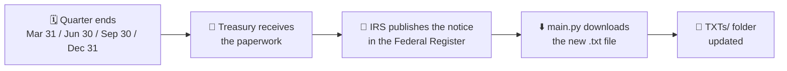

### 📆 When do the lists appear?

Across all 120 lists, publication clusters in four windows, one per quarter: **late January to February**, **late April to May**, **late July to August**, and **late October to November**.

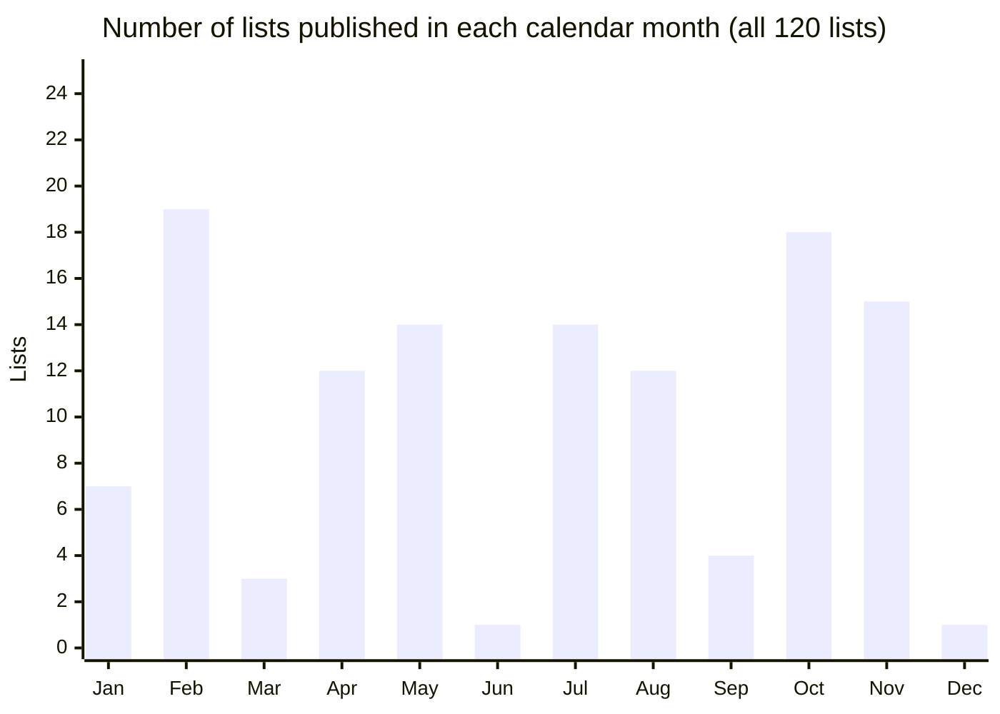

| Quarter covered | 🗓️ Quarter ends | 📰 Usually published           |
| --------------- | --------------- | ------------------------------ |
| Q1              | March 31        | Late April to May              |
| Q2              | June 30         | Late July to August            |
| Q3              | September 30    | Late October to mid-November   |
| Q4              | December 31     | Late January to early February |

Lists appear on weekdays only, and **Thursday is the most common day** (39 of 120):

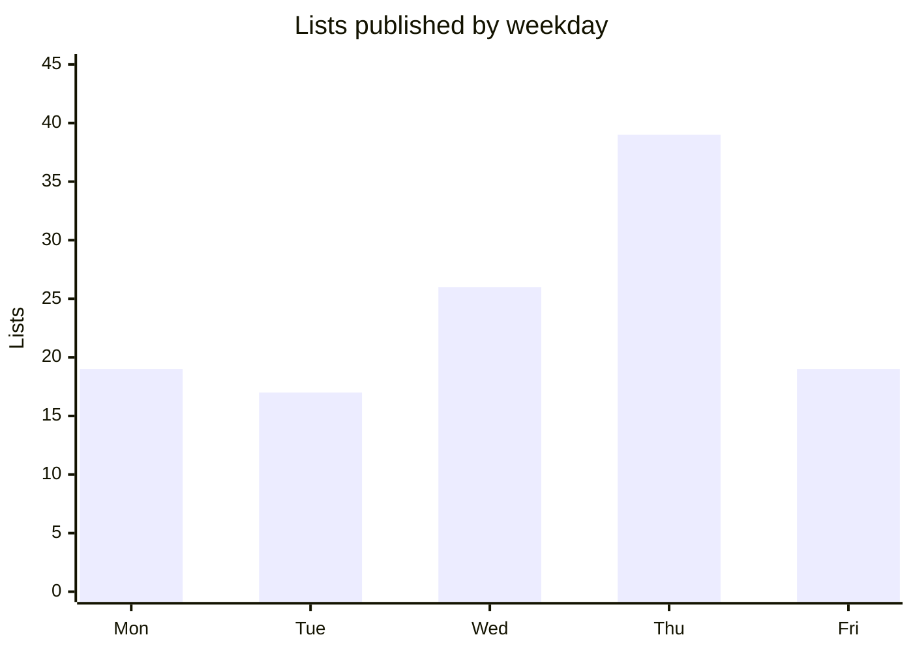

Recent examples: Q4 2025 on **2026-01-23**, Q1 2026 on **2026-04-22**, Q2 2026 on **2026-07-23**, and Q3 2026 on **2026-10-30**.

---

## 📦 What is in this repository

```text
usa-quarterly-expatriation-list/
├── 📄 README.md                    ← you are here
├── 🐍 main.py                      ← the downloader (Python standard library only)
└── 📁 TXTs/                        ← one text file per Federal Register notice (135 files)
    ├── 1997-01-30_97-2283.txt
    ├── …
    └── 2026-10-30_2026-22229.txt
```

📌 **File naming:** `YYYY-MM-DD_<federal-register-document-number>.txt`. The date is the publication date, so the folder sorts chronologically.

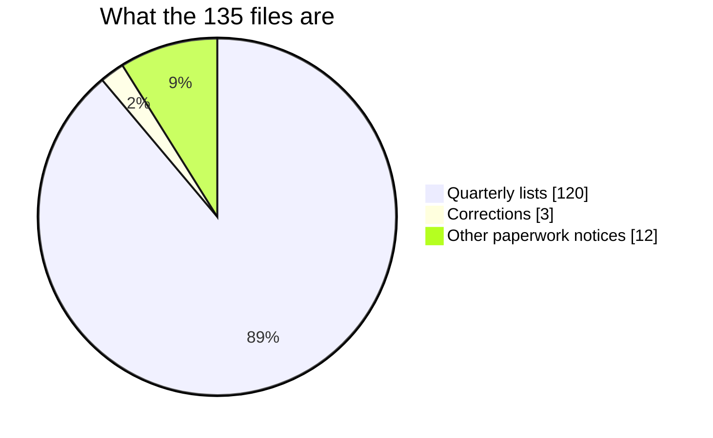

### 🧬 Anatomy of a notice

Every file is the text version of a Federal Register page, wrapped in a little HTML. Each quarterly list has the same skeleton:

1. A header with the volume, issue, page range and document number.
2. A short paragraph naming the law and **the quarter** the list covers ("the quarter ending ...").
3. A table of names. **Every list since late 2009 is sorted alphabetically by last name**; 25 lists published between 2002 and mid-2009 are not, so scan those in full.
4. A signature block, then the filing line.

The layout of the name table has changed over the years:

| Layout of the names                                       | Lists | When                                     |
| --------------------------------------------------------- | ----: | ---------------------------------------- |
| Three dotted columns: `LAST.......  FIRST.......  MIDDLE` |   111 | July 1997 to 2026                        |
| One name per line as `Last, First Middle`                 |     7 | 1997 to 2004                             |
| One name per line as `First Middle Last`                  |     2 | October 2004 (part of a five-list batch) |

Some lists also wrap very long names onto a second line.

---

## 📊 The data at a glance

All counts are the **number of name entries per list**, grouped by the quarter the list covers.

### 📈 Names published per year, 1997 to 2025

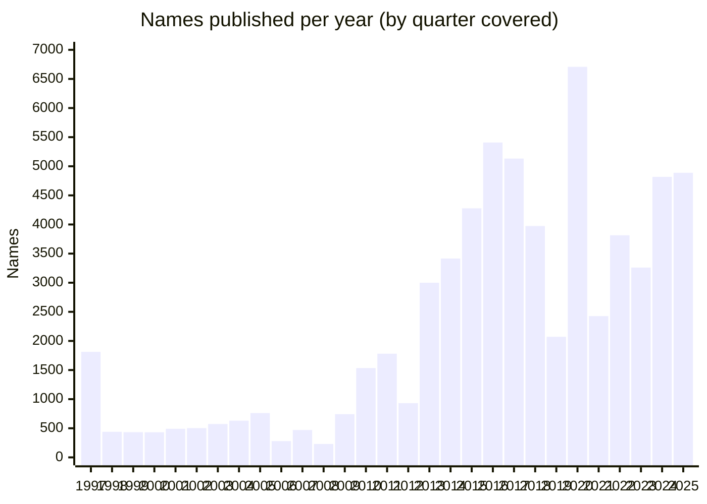

> 🕰️ The early years look tiny next to today: from 1998 to 2009 the average was about **499 names a year**, while 2021 to 2025 averaged about **3,841**. The only early outlier is 1997, whose Q2 list held about 1,200 names, a one-off batch that stayed the biggest list ever published until May 2015.

### 🔬 Quarter by quarter, Q1 2016 to Q3 2026

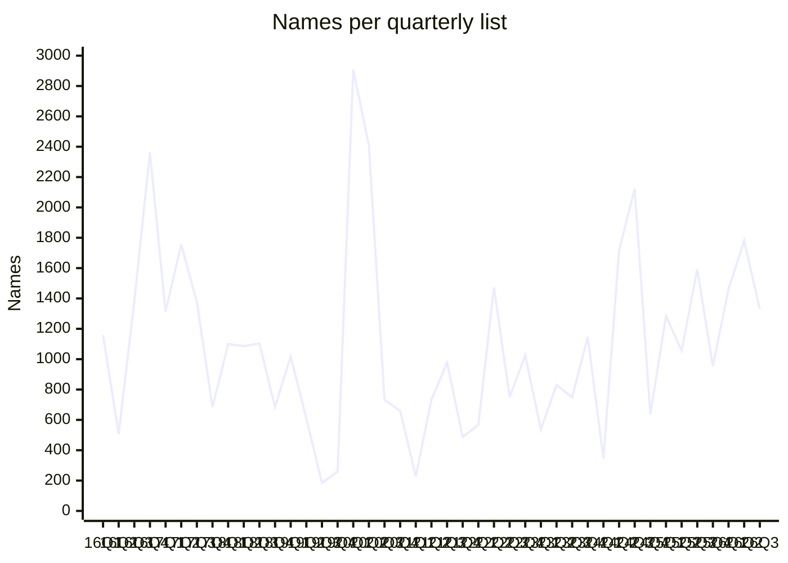

### 🧮 Year-by-year table (2010 to 2025)

| 📅 Year             |  👥 Names |
| ------------------- | --------: |
| 2010                |     1,534 |
| 2011                |     1,781 |
| 2012                |       932 |
| 2013                |     3,000 |
| 2014                |     3,415 |
| 2015                |     4,278 |
| 2016                |     5,408 |
| 2017                |     5,132 |
| 2018                |     3,974 |
| 2019                |     2,071 |
| 2020                |     6,708 |
| 2021                |     2,426 |
| 2022                |     3,815 |
| 2023                |     3,260 |
| 2024                |     4,818 |
| 2025                |     4,888 |
| **2026 (Q1 to Q3)** | **4,574** |

### 🏔️ The ten biggest lists ever

|   # | Quarter covered | Published  |  👥 Names | Federal Register pages |
| --: | --------------- | ---------- | --------: | ---------------------: |
|   1 | 2020 Q1         | 2020-05-08 | **2,907** |                     40 |
|   2 | 2020 Q2         | 2020-08-06 | **2,409** |                     34 |
|   3 | 2016 Q4         | 2017-02-09 | **2,363** |                     33 |
|   4 | 2024 Q3         | 2024-10-29 | **2,122** |                     30 |
|   5 | 2026 Q2         | 2026-07-23 | **1,781** |                     25 |
|   6 | 2017 Q2         | 2017-08-03 | **1,758** |                     25 |
|   7 | 2024 Q2         | 2024-08-01 | **1,717** |                     25 |
|   8 | 2025 Q3         | 2025-11-17 | **1,593** |                     23 |
|   9 | 2022 Q2         | 2022-07-28 | **1,473** |                     21 |
|  10 | 2026 Q1         | 2026-04-22 | **1,462** |                     21 |

### 📚 Running total

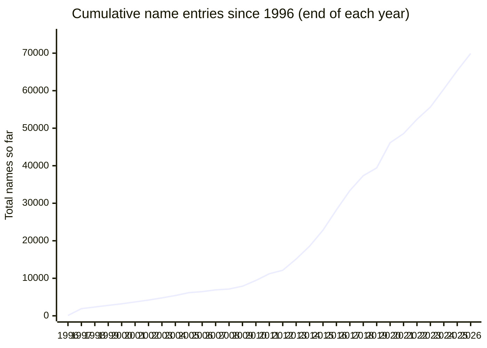

### 🥧 Where the names come from, by era

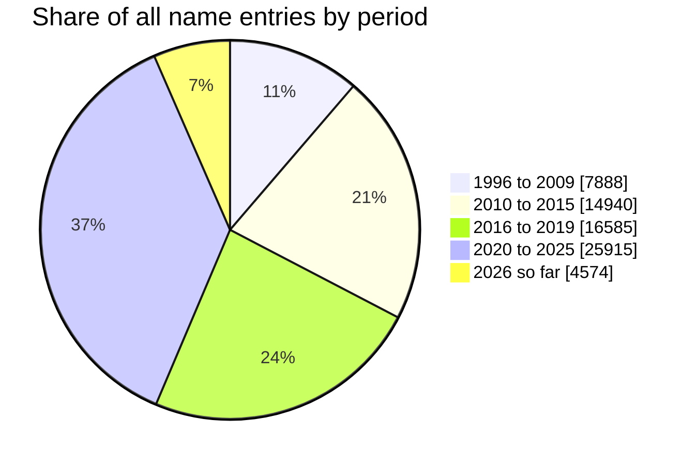

### 📉📈 Year-over-year change (%)

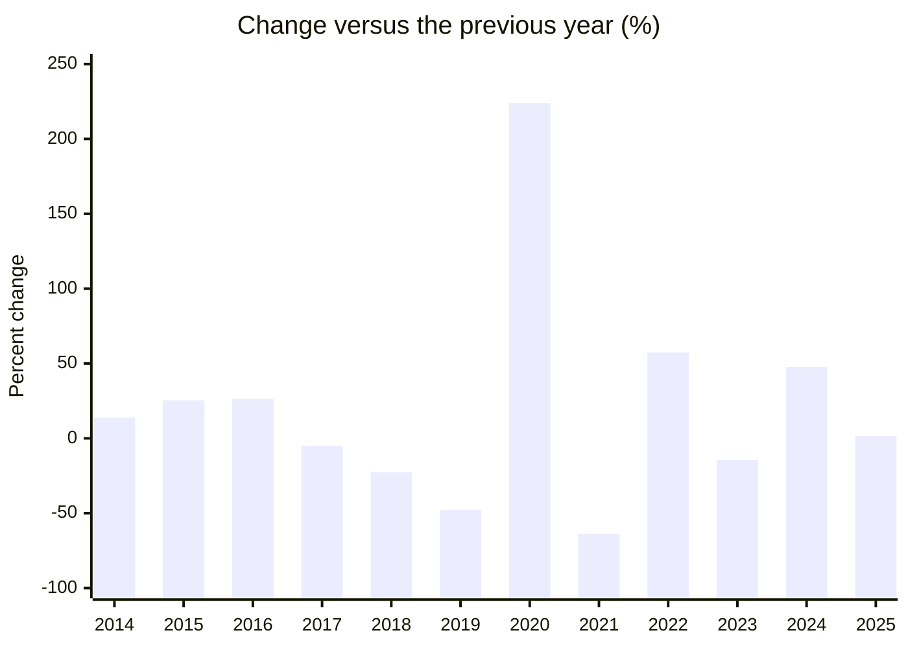

### 🗓️ Is there a seasonal pattern?

Average list size by quarter of the year, 2013 to 2025:

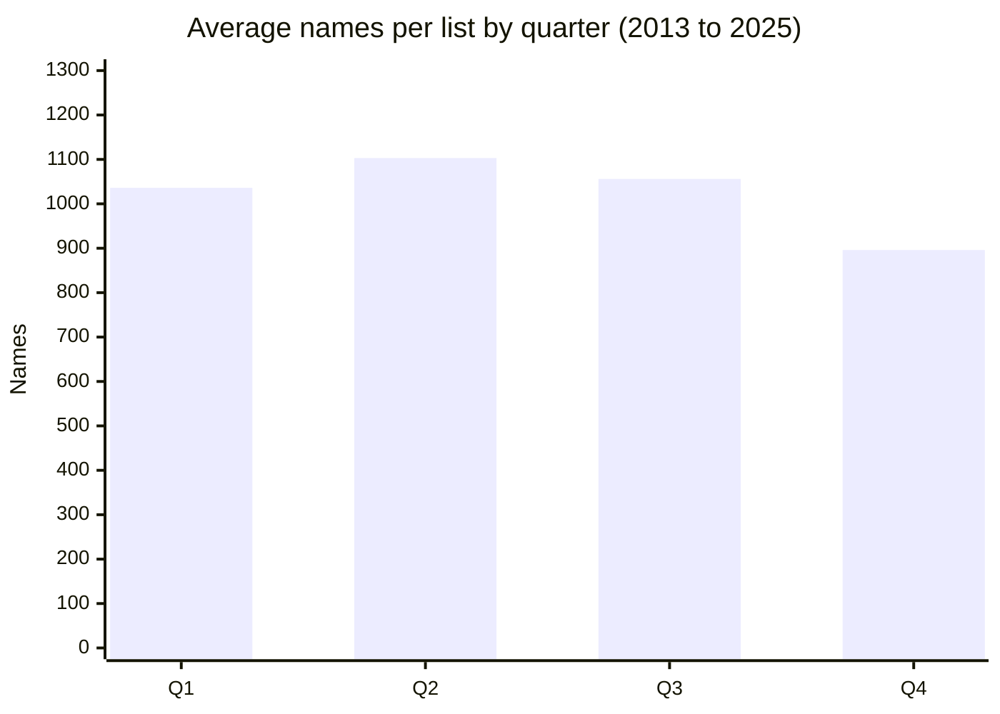

📝 The differences are mild next to the year-to-year swings: Q4 lists run a little smaller on average, but no quarter is reliably the biggest.

### 📦 How big is a typical list?

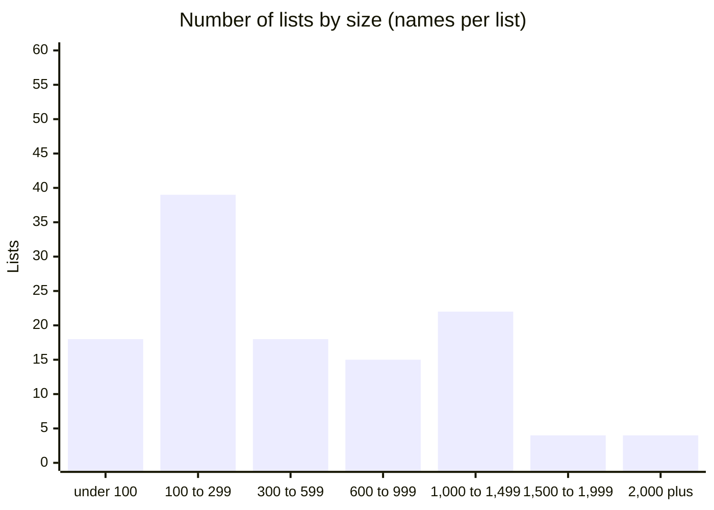

Half of all lists have fewer than 398 names, but that is dominated by the quiet years before 2010. Since 2013 the average list holds about 1,050 names.

---

## 🔬 Deep dive into the files

### 🌋 The 2020 spike: a backlog, not a sudden exodus

The two lists for the second half of 2019 were tiny (**444 names combined**), and then the two lists for the first half of 2020 were enormous (**5,316 names combined**, 79% of the record 2020 total of 6,708). Lists reflect when Treasury _received_ information, so a slow patch followed by a catch-up produces exactly this shape. Treat single-quarter spikes and dips as processing effects first.

### ⏱️ How punctual is the IRS?

The statute sets a 30-day deadline. Counting from the quarter-end date printed in each notice to the day it appeared in the Federal Register:

| 📏 Measure                          | Value                   |
| ----------------------------------- | ----------------------- |
| Median delay, lists for 2017 onward | **30 days** (mean 33.5) |
| Lists within 30 days, 2017 onward   | **20 of 39**            |
| Lists within 30 days, 2022 onward   | **16 of 19**            |
| Fastest recent list                 | 19 days (Q1 2023)       |
| Slowest recent list                 | 72 days (Q4 2018)       |

In other words, only 4 of the 20 lists for 2017 through 2021 met the deadline, but **16 of the 19 lists since 2022 did**. Publication has become noticeably more punctual.

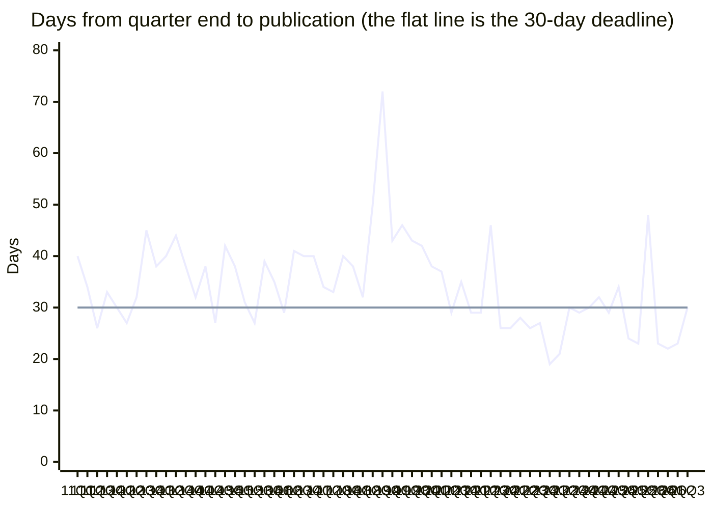

### 🐢 The nine catch-up lists

Nine lists appeared **more than four months** after their quarter ended. Many of the early ones came out in batches: three lists were published together on 2001-09-24 and five together on 2004-10-21.

| Quarter covered | Published  | Days after quarter end | 👥 Names |
| --------------- | ---------- | ---------------------: | -------: |
| 1998 Q1         | 1999-09-08 |                    526 |      136 |
| 2000 Q4         | 2001-09-24 |                    267 |       69 |
| 2001 Q1         | 2001-09-24 |                    177 |      225 |
| 2001 Q3         | 2002-03-13 |                    164 |      123 |
| 2003 Q3         | 2004-10-21 |                    387 |      115 |
| 2003 Q4         | 2004-10-21 |                    295 |      135 |
| 2004 Q1         | 2004-10-21 |                    204 |      108 |
| 2005 Q2         | 2006-11-28 |                    516 |      416 |
| 2010 Q2         | 2010-11-10 |                    133 |      560 |

### 📄 Size of the notices

- The 120 lists together fill **1,048 Federal Register pages**.
- Since 2013 a page holds about **68 names**, so the page count is a handy size check.
- The longest notice is Q1 2020 at **40 pages** (document 2020-09814), followed by Q2 2020 at 34 and Q4 2016 at 33.

### 👥 What the names themselves can tell us (aggregates only)

These statistics treat each entry as a row of text and never single anyone out.

| 🔍 Finding                                                      | Value      |
| --------------------------------------------------------------- | ---------- |
| Entries analysed (118 lists with last-name-first layout)        | 69,652     |
| Distinct "last name + first name + middle initial" combinations | **67,262** |
| Repeat entries (the entries minus the distinct combinations)    | 2,390      |
| Combinations that appear in more than one list                  | 2,123      |
| Exact repeats inside a single list                              | 136        |
| Entries that include a middle name or initial                   | **76%**    |
| Entries sharing a last name with another entry in the same list | **25%**    |

**Repeat appearances.** Of the 2,254 gaps between repeat appearances, the most common is exactly one list later (30%), and about 7 in 10 fall within six lists.

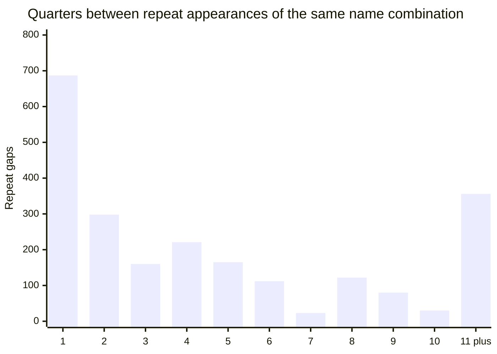

⚠️ A repeat can mean a re-listing, a data correction, or simply **two different people with the same name**, so these numbers are an upper bound on re-listings, and entries are not the same thing as distinct people.

**Households.** About **25%** of entries share a last name with another entry in the same list, which is consistent with family members expatriating together (common surnames also inflate this):

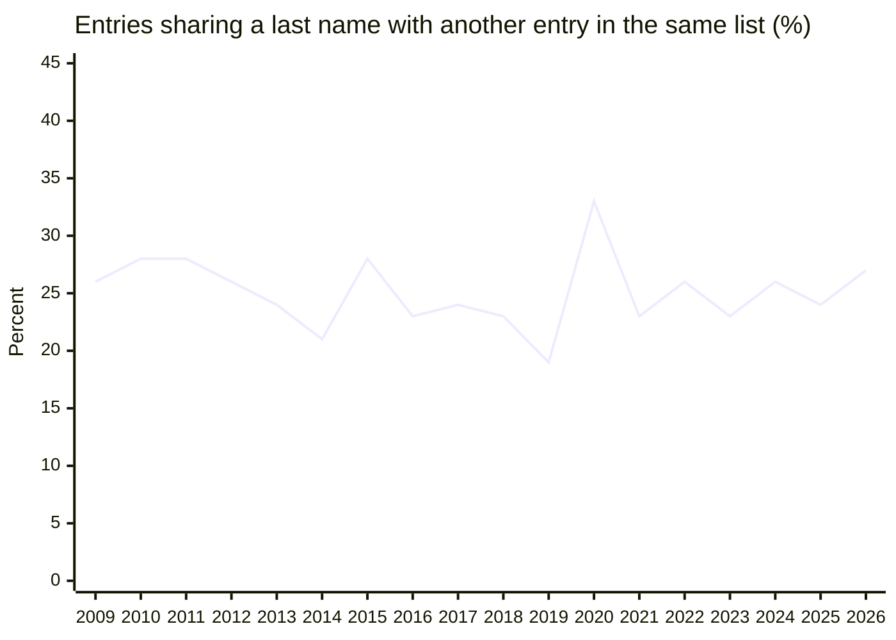

**Name format.** The share of entries with a middle name or initial stayed between roughly 63% and 86%, and dipped in 2020 and 2021:

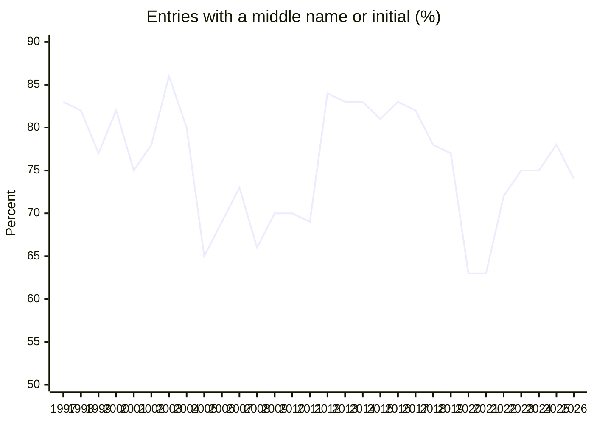

### 🕰️ Milestones found in the files

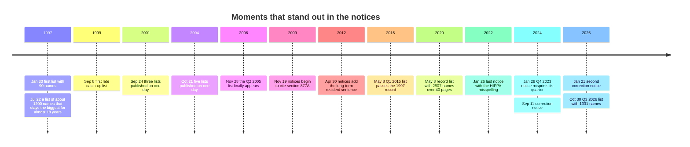

### 🧐 Curiosities hidden in the text

- ✏️ **A misprinted quarter.** The Q4 2023 list (published 2024-01-29) says its quarter ends September 30, 2023. A correction notice on 2024-09-11 fixes it to December 31, 2023, and a second correction on 2026-01-21 amends a single name entry on page 5619, almost two years after the original.
- 🔤 **"HIPPA" versus "HIPAA".** 95 of the 120 lists misspell the 1996 health-insurance law as "HIPPA"; the last one is from 2022-01-26, and every list since April 2022 spells it correctly.
- 🔢 **Section numbers.** The titles of the 1997 and early 1998 notices cite a changing section number (877(a), 3069F, 6039F and 6039(f), where 3069F and 6039F look like misprints) before settling on 6039G in August 1998. The phrase "as Required by Section 6039G" is in the title of 91 lists, last used in July 2021.
- 🧾 **Who signs.** The notices have been issued by a series of IRS units:

| Period       | Signing unit                                                                                  |
| ------------ | --------------------------------------------------------------------------------------------- |
| 1997 to 2000 | International District Operations                                                             |
| 2000 to 2001 | Small Business/Self-Employed, Compliance Area 15                                              |
| 2002 to 2021 | Philadelphia Compliance Services                                                              |
| 2021 to 2026 | Large Business and International and Compliance Support, Development and Communications teams |

---

## 🚀 How to use this list

### 👀 1. Browse and search (no setup needed)

Open any file in the `TXTs/` folder on GitHub. To search every notice at once from a terminal:

```bash
# 🔍 case-insensitive search across all notices, showing file name and line number
grep -i -n "lastname" TXTs/*.txt
```

On GitHub you can also press <kbd>t</kbd> to find a file by name, or use the repository search box. Every list since late 2009 is **sorted alphabetically by last name**, so you can jump straight to the right neighbourhood of a file (25 lists published between 2002 and mid-2009 are not sorted, so search those in full).

### 🐍 2. Search with Python

```python
import pathlib  # handles file system paths
import re  # provides regular expressions

search_surname = "Smith"  # the surname to look for, change it to yours
search_pattern = re.compile(re.escape(search_surname), re.IGNORECASE)  # build a case-insensitive pattern
for text_file_path in sorted(pathlib.Path("TXTs").glob("*.txt")):  # visit every notice in date order
    file_text = text_file_path.read_text(encoding="utf-8", errors="replace")  # read the file without crashing on odd characters
    for line_number, line_text in enumerate(file_text.splitlines(), start=1):  # walk through every line with its number
        if search_pattern.search(line_text):  # the surname appears on this line
            print(f"{text_file_path.name}:{line_number}: {line_text.strip()}")  # show where the match was found
```

### 🧮 3. Reproduce the counts yourself

This script (standard library only) classifies every file, counts the names in each quarterly list and writes `lists_summary.csv` with the publication date, the quarter covered, the number of names and the delay in days. It reproduces every count on this page: **120 lists and 69,902 names**.

<details>
<summary>📜 Show the script (<code>summarize_lists.py</code>)</summary>

```python
import csv  # writes the summary table
import datetime  # parses and subtracts dates
import pathlib  # handles file system paths
import re  # provides regular expressions

STOP_PATTERN = re.compile(r"^\s*(Dated|Approved)\b|^\s*\[?FR Doc|BILLING CODE", re.IGNORECASE)  # lines that end the table of names
HEADER_PATTERN = re.compile(r"^\s*(last|lname|first|fname|middle|mname|initials|\(last)\b", re.IGNORECASE)  # column heading rows
QUARTER_END_CORRECTIONS = {"2024-01-29_2024-01648.txt": datetime.date(2023, 12, 31)}  # that notice misprinted its quarter; two later corrections fixed it


def is_table_line(line_text: str) -> bool:  # true for rows that look like "LAST.....  FIRST.....  MIDDLE"
    return ".." in line_text or re.search(r"\S\s{2,}\S", line_text.strip()) is not None  # dotted leaders or wide gaps between columns


def read_quarter_end(plain_text: str) -> datetime.date | None:  # finds the "quarter ending Month D, YYYY" date
    match_result = re.search(r"quarter\s+ending\s+([A-Za-z]+\s+\d{1,2},\s+\d{4})", plain_text, re.IGNORECASE)  # first mention in the notice
    if match_result is None:  # no such sentence
        return None  # not a list
    return datetime.datetime.strptime(match_result.group(1).title(), "%B %d, %Y").date()  # convert the text to a date


def count_names(plain_text: str) -> int:  # counts the name entries in one quarterly list
    text_lines = plain_text.splitlines()  # work line by line
    index = next(position for position, line_text in enumerate(text_lines) if re.search(r"quarter\s+ending", line_text, re.IGNORECASE))  # line with the quarter sentence
    while not text_lines[index].rstrip().endswith("."):  # skip the rest of the introduction
        index += 1  # move to the next line
    candidate_lines = []  # lines that might be names
    for line_text in text_lines[index + 1:]:  # everything after the introduction
        if STOP_PATTERN.match(line_text):  # reached the signature block
            break  # stop collecting
        stripped_text = line_text.rstrip()  # drop trailing spaces
        is_noise = (not stripped_text.strip()) or re.match(r"^[-=_\s]+$", stripped_text) or re.match(r"^\s*\[\[?Page", stripped_text) or re.match(r"^\s*SUPPLEMENTARY INFORMATION", stripped_text, re.IGNORECASE) or HEADER_PATTERN.match(stripped_text)  # blanks, rules, page marks, headings
        if not is_noise:  # a real candidate line
            candidate_lines.append(stripped_text)  # keep it
    table_share = sum(is_table_line(line_text) for line_text in candidate_lines) / max(1, len(candidate_lines))  # how table-like the block is
    if table_share >= 0.5:  # dotted-column layout (most lists since 1997)
        return sum(is_table_line(line_text) for line_text in candidate_lines)  # ignore wrapped continuation lines
    return len(candidate_lines)  # one name per line (a few early lists)


summary_rows = []  # one row per quarterly list
for text_file_path in sorted(pathlib.Path("TXTs").glob("*.txt")):  # every downloaded notice, oldest first
    raw_text = text_file_path.read_text(encoding="utf-8", errors="replace")  # read the file
    front_matter = raw_text[:2600]  # the heading area is enough to classify it
    if "Quarterly Publication" not in front_matter or re.search(r"correction", front_matter, re.IGNORECASE):  # paperwork notice or correction
        continue  # only the quarterly lists are summarised
    plain_text = re.sub(r"<[^>]+>", "", raw_text)  # remove the html tags around the text
    publication_date = datetime.date.fromisoformat(text_file_path.name[:10])  # the date is the start of the file name
    quarter_end = QUARTER_END_CORRECTIONS.get(text_file_path.name, read_quarter_end(plain_text))  # use the known fix when needed
    summary_rows.append({"file_name": text_file_path.name, "publication_date": publication_date, "quarter_end": quarter_end, "names_in_list": count_names(plain_text), "days_after_quarter_end": (publication_date - quarter_end).days})  # one summary row

with open("lists_summary.csv", "w", newline="", encoding="utf-8") as csv_file:  # write the table next to the script
    csv_writer = csv.DictWriter(csv_file, fieldnames=list(summary_rows[0]))  # column names come from the first row
    csv_writer.writeheader()  # header line
    csv_writer.writerows(summary_rows)  # all rows

print(f"{len(summary_rows)} lists, {sum(row['names_in_list'] for row in summary_rows)} names in total")  # quick check
```

</details>

Save it as `summarize_lists.py` in the repository root and run `python summarize_lists.py` (it is optional; the repository itself only needs `main.py`). Open the CSV in Excel, Google Sheets, pandas or R to make your own charts.

### ⬇️ 4. Download or refresh the files

`main.py` talks to the free [Federal Register API](https://www.federalregister.gov/developers/documentation/api/v1) (no API key needed), searches for `6039G`, and saves each notice into `TXTs/`. **Files that already exist are skipped**, so it is safe to run again every quarter.

```bash
# 👀 step 1: preview what would be downloaded (nothing is saved)
python main.py --dry-run --contact-email you@yourdomain.com

# ⬇️ step 2: download everything that is new
python main.py --contact-email you@yourdomain.com
```

Requirements: **Python 3.12 or newer** and nothing else (standard library only).

| ⚙️ Option                        | 📖 What it does                                                  | Default           |
| -------------------------------- | ---------------------------------------------------------------- | ----------------- |
| `--output-directory`             | Folder for the downloaded files                                  | `TXTs`            |
| `--contact-email`                | Your email, sent in the `User-Agent` header (good API etiquette) | `you@example.com` |
| `--dry-run`                      | List matching documents without downloading                      | off               |
| `--extra-search-term`            | Add another search term (repeatable)                             | none              |
| `--maximum-concurrent-downloads` | Simultaneous downloads                                           | `3`               |
| `--delay-seconds`                | Pause after each download, to be polite to the server            | `1.0`             |
| `--api-documents-url`            | Override the search endpoint (useful for testing)                | official endpoint |

🪵 The program logs everything to the console at DEBUG level, so you can see each request, response and file written.

---

## 💡 Use this data for your own benefit

| 🎯 If you are...                            | 🛠️ Try this                                                                                                                                                                                                                                                                                                        |
| ------------------------------------------- | ------------------------------------------------------------------------------------------------------------------------------------------------------------------------------------------------------------------------------------------------------------------------------------------------------------------ |
| 👤 **An individual or family member**       | Check whether and when a name was published with the `grep` command above. Use the delay statistics (median about 30 days, longer in catch-up periods) to know when to expect a listing, and remember that **absence from the list is not proof of anything** (see [limitations](#-limitations-and-data-quality)). |
| 🧬 **A genealogist or family historian**    | Look for relatives who gave up citizenship since 1996. The quarter of the list tells you roughly when Treasury heard about it. Please treat these records with respect.                                                                                                                                            |
| 🧑‍💼 **A tax or immigration adviser**         | Plan capacity with the seasonal and yearly volumes, set client expectations with the real publication timing, and keep a local, citable copy of the official record.                                                                                                                                               |
| 🏢 **A compliance, HR or mobility team**    | Use the list as one public data point when documenting a lawful, case-specific review. It is **not a watch list** and says nothing about why someone left.                                                                                                                                                         |
| 🎓 **A student or researcher**              | Model the quarterly series (trend, seasonality, the 2020 break), forecast the next list, or study how the notice wording changed. The three name layouts, wrapped lines and misprints make it an excellent **real-world data-cleaning exercise**.                                                                  |
| 📰 **A journalist or analyst**              | Verify "record" claims against the actual numbers (for example, 1,781 names in Q2 2026 is 69% above 1,056 in Q2 2025), and quote the exact list, date and page.                                                                                                                                                    |
| 🧑‍💻 **A developer or data scientist**        | Build a CSV, a SQLite database, a dashboard or a notebook from the text files, or add tests that catch parsing regressions.                                                                                                                                                                                        |
| 🧭 **Anyone curious about a policy debate** | Put numbers behind discussions of renunciation fees, citizenship-based taxation and cross-border reporting, while remembering that counts reflect when information was received.                                                                                                                                   |

### 🔮 A worked example: is 2026 a record year?

Three lists are in for 2026 (1,462 + 1,781 + 1,331 = **4,574 names**). A Q4 2026 list of just **315 names** would make 2026 bigger than 2025 (4,888), and **245** would already beat 2024 (4,818). Beating the 2020 record of 6,708 would need a Q4 list of about 2,100 names, which has happened only four times in 30 years.

---

## 🌍 Benefits for the community

- 🔍 **Accountability for a legal deadline.** Because the statute sets a 30-day limit, an open archive lets anyone see the track record: only 4 of 20 lists for 2017 to 2021 were on time, versus 16 of 19 since 2022. Public data keeps public duties visible.
- 🗄️ **A durable public record.** Federal Register pages can move, change layout or become hard to search. A versioned Git archive keeps the complete 1997 to 2026 series safe, diff-able and easy to mirror.
- 📊 **Shared facts for public debate.** People of every viewpoint argue about expatriation. A neutral, reproducible set of counts (with the methods in the open) gives everyone the same starting point instead of competing, unsourced numbers.
- 🌐 **Support for Americans abroad and the groups that serve them.** Advocacy groups, support organisations and advisers can cite exact figures, timings and corrections rather than rumours.
- 🎓 **Data-literacy teaching material.** Real, messy, public data (three layouts, a misprinted quarter, batch publications) is perfect for classrooms, bootcamps and workshops.
- 🤖 **Open tools lower the barrier.** One dependency-free script and one summary script mean a student with a laptop can reproduce the same results as a professional analyst.
- 🔓 **Open-government by example.** The same pattern (fetch from a public API, skip what you already have, publish the method) can be reused for any other recurring government notice.

### 🤝 Ways to contribute

| 💡 Idea                                                                                                                       | 🧰 Skill level |
| ----------------------------------------------------------------------------------------------------------------------------- | -------------- |
| Add a tested parser that writes one clean CSV row per name entry (with responsible-use notes)                                 | Intermediate   |
| Add a small test-suite that checks every list's count against `lists_summary.csv`                                             | Beginner       |
| Build a static dashboard (GitHub Pages) from `lists_summary.csv`                                                              | Intermediate   |
| Compare these counts with other public renunciation statistics and document the differences                                   | Intermediate   |
| Improve the handling of wrapped long names and document the accuracy gain                                                     | Advanced       |
| Translate this README                                                                                                         | Beginner       |
| Add the optional [GitHub Actions workflow](#-keeping-the-repository-fresh) and report how it behaves around publication dates | Beginner       |

---

## 🚧 Limitations and data quality

- 🧮 **Counts come from parsing.** They can differ by a few entries from other published tallies, and three early lists differ more: Q2 1998 (116 names in the file), Q2 2001 (122) and Q3 2004 (243). The files themselves are the source of truth.
- 📄 **12 of the 135 files are not name lists.** The Federal Register search for `6039G` also returns routine paperwork-clearance notices (for example requests for comments on Form 8854, the expatriation information statement) that merely mention the law. To see them, run `grep -L "Quarterly Publication" TXTs/*.txt`. Three more files are correction notices.
- 🕒 **The list shows when Treasury received information,** not the exact day someone renounced. A person can appear many months later, and in a few early periods whole lists were published in catch-up batches.
- 🙈 **It may be incomplete.** Practitioners disagree on whether every former citizen is included.
- 👥 **It mixes groups.** Former long-term green-card holders are included alongside former citizens.
- 🔁 **Entries can repeat.** A repeat can be a re-listing, a correction or a different person with the same name. Entries are not the same as distinct people.
- 🏷️ **Names only.** There is no country, age or reason, so you cannot tell _why_ someone left.
- 🧵 **Wrapped names.** In some lists a long name wraps onto a second line. The counting method treats the second line as part of the same entry.
- 🔀 **Not every list is sorted.** 25 lists published between 2002 and mid-2009 are not in alphabetical order, so search them in full rather than jumping to a letter.

---

## 🤝 Responsible use

The notices contain **real people's names** and are public records. Please use them for research, journalism, compliance checks and personal curiosity, and **do not use them to harass, doxx, stalk or shame anyone.** In particular:

- 🚫 Do not guess a person's nationality, ethnicity, religion or motives from a name.
- 🔒 Publish aggregates (counts, trends, timings) rather than lists of individuals.
- 🤲 Remember that people leave the U.S. system for many personal, family, financial and professional reasons.

---

## 🛠️ Installation and Setup

Follow these steps to install the required applications, download the repository, configure Python and run the automatic Federal Register downloader.

### 1\. Install the required applications

On Ubuntu or Debian-based Linux distributions, open a terminal and run:

bash

```bash
sudo apt-get update

sudo apt-get install bash git coreutils util-linux findutils grep sed gawk psmisc openssh-client ca-certificates python3 python3-pip python3-venv python3-lxml python3-psutil iputils-ping xvfb nodejs golang-go -y
```

This installs Git, Python, system utilities and the additional applications specified for the environment.

### 2\. Clone the repository

Download the project from GitHub:

bash

```bash
git clone git@github.com:CoreData-Labs/usa-quarterly-expatriation-list.git
```

**Note:** SSH access requires a configured GitHub SSH key. If you have not configured one, you can use HTTPS instead:

bash

```bash
git clone https://github.com/CoreData-Labs/usa-quarterly-expatriation-list.git
```

### 3\. Enter the project directory

bash

```bash
cd usa-quarterly-expatriation-list
```

### 4\. Create a Python virtual environment

A virtual environment keeps project dependencies separate from your system-wide Python installation.

bash

```bash
python3 -m venv .venv
```

### 5\. Activate the virtual environment

bash

```bash
source .venv/bin/activate
```

After activation, your terminal should display `(.venv)`.

### 6\. Install the Python packages

Install the dependencies listed in the project's requirements file:

bash

```bash
pip install -r requirements.txt
```

If the project does not contain a `requirements.txt` file, check its dependency instructions before running this command. The current downloader is designed to use the Python standard library and does not require third-party packages.

### 7\. Run the Python downloader

Start the program:

bash

```bash
python3 main.py
```

The program communicates with the Federal Register API, searches for relevant expatriation notices and downloads new documents into the `TXTs/` directory.

### 8\. Verify the downloaded files

bash

```bash
ls -lh TXTs/
```

You can also check the number of archived documents:

bash

```bash
find TXTs/ -type f -name "*.txt" | wc -l
```

**Installation complete\!** You can now use Python to download, archive and maintain the quarterly expatriation notices.

---

## 🤖 How Python Automatically Maintains This List

One of the main goals of this repository is to make maintaining the USA Quarterly Expatriation List as simple and reliable as possible.

Instead of manually visiting the Federal Register website every quarter, downloading documents and organizing them into folders, Python handles the repetitive work automatically.

### 🧠 How the automation works

The project uses Python and the official Federal Register API to discover and download new notices.

The process follows these steps:

1. **Connect to the Federal Register API:** Python sends a request to the public Federal Register API.
2. **Search for relevant notices:** The program searches for documents associated with Section 6039G.
3. **Retrieve publication information:** It identifies document titles, publication dates and document numbers.
4. **Check existing files:** Before downloading anything, Python checks whether the document already exists in the local archive.
5. **Download new documents:** Only documents that are not already archived are downloaded.
6. **Save the documents:** Each notice is saved as a plain-text `.txt` file inside `TXTs/`.
7. **Maintain chronological organization:** The publication date and Federal Register document number are used to create consistent filenames.

### 🔄 The automatic maintenance workflow

mermaid

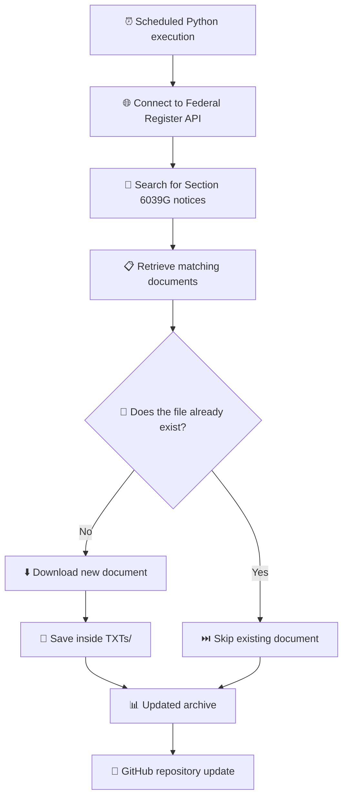

### 🐍 How Python prevents duplicate downloads

An important feature is that existing files are skipped.

This means you can execute:

bash

```bash
python3 main.py
```

multiple times without unnecessarily downloading the same documents again.

For example:

| Situation                           | Python action                                       |
| ----------------------------------- | --------------------------------------------------- |
| First execution                     | Downloads all matching notices not already archived |
| Second execution                    | Skips existing files                                |
| New quarterly notice appears        | Downloads the new notice                            |
| Existing notice is discovered again | Skips its existing file                             |
| Repository is updated               | New files can be committed to GitHub                |

This makes the downloader suitable for scheduled execution.

### 🧪 Preview new documents before downloading

You can use the dry-run option to check which documents the program identifies without saving them.

bash

```bash
python3 main.py --dry-run --contact-email you@yourdomain.com
```

When you are ready, run:

bash

```bash
python3 main.py --contact-email you@yourdomain.com
```

Replace the example email with an appropriate contact email address.

### ☁️ Automatically update GitHub using GitHub Actions

Python can perform the downloading, while GitHub Actions can schedule the execution and publish new files to the repository.

Create this file:

text

```text
.github/workflows/quarterly-update.yml
```

Add the following configuration:

yaml

```yaml
name: Update expatriation notices

on:
  schedule:
    - cron: "0 12 * * 1"
  workflow_dispatch:

permissions:
  contents: write

jobs:
  update:
    runs-on: ubuntu-latest

    steps:
      - name: Checkout repository
        uses: actions/checkout@v4

      - name: Set up Python
        uses: actions/setup-python@v5
        with:
          python-version: "3.12"

      - name: Download new Federal Register notices
        run: |
          python main.py --contact-email ${{ secrets.CONTACT_EMAIL }}

      - name: Commit and push new documents
        run: |
          git config user.name "github-actions[bot]"
          git config user.email "github-actions[bot]@users.noreply.github.com"

          git add TXTs/

          git diff --cached --quiet || \
            git commit -m "Add new quarterly expatriation notice"

          git push
```

Add a GitHub Actions repository secret named `CONTACT_EMAIL` containing your contact email address.

The workflow checks the Federal Register every Monday at 12:00 UTC. You can also trigger it manually from the GitHub Actions tab.

### 📅 Why check every week?

The government publishes these notices quarterly, but publication dates can vary.

A weekly schedule offers several advantages:

- Detects new notices without waiting for someone to run the script.
- Reduces the possibility of missing a publication.
- Avoids unnecessary downloads because existing files are skipped.
- Keeps the GitHub archive updated.
- Provides a repeatable process that contributors can maintain.

### 📊 What happens after a new notice is published?

Suppose the Federal Register publishes a new quarterly notice.

The automated process will:

1. Detect the new publication through the API.
2. Retrieve its document information.
3. Download the text version.
4. Save it under the correct publication-date filename.
5. Commit the new document to GitHub.
6. Make the updated archive available to everyone.

No manual file downloading or uploading is necessary.

### 🛡️ Important maintenance recommendations

- Keep the Python downloader compatible with Python 3.12 or newer.
- Check the GitHub Actions execution logs periodically.
- Verify that downloaded documents are genuine Federal Register notices.
- Keep correction notices rather than silently replacing historical records.
- Review parsing logic whenever the Federal Register changes its document layout.
- Recalculate the statistics and update the README when new quarterly lists are added.
- Preserve the original source documents so researchers can reproduce the results.

**The main idea:** Python handles data collection, GitHub Actions handles scheduling and publishing, and Git stores the historical archive.

Together, these tools make it possible to maintain a public quarterly expatriation archive with very little manual intervention.

---

## 📚 Sources

- 📁 **The files in `TXTs/`**, downloaded from the Federal Register, are the primary source for every number on this page except where stated.
- 🏛️ [Federal Register: Quarterly Publication of Individuals, Who Have Chosen To Expatriate](https://www.federalregister.gov/quarterly-publication-of-individuals-who-have-chosen-to-expatriate)
- 🧑‍💻 [Federal Register API documentation](https://www.federalregister.gov/developers/documentation/api/v1)
- ⚖️ [26 U.S.C. § 6039G (Cornell Legal Information Institute)](https://www.law.cornell.edu/uscode/text/26/6039G) and the [U.S. Code edition at govinfo](https://www.govinfo.gov/link/uscode/26/6039G?link-type=html) (the 30-day requirement)
- 📖 [Wikipedia: Quarterly Publication of Individuals Who Have Chosen to Expatriate](https://en.wikipedia.org/wiki/Quarterly_Publication_of_Individuals_Who_Have_Chosen_to_Expatriate) (history and an independent compilation of quarterly counts)

---

## 📝 Disclaimer

This repository is an **unofficial** convenience archive. The Federal Register website itself states that it is not the official legal edition, and the official version is the PDF published through [govinfo.gov](https://www.govinfo.gov/). Counts and commentary here are informational only and are **not legal, tax or immigration advice**. If a decision depends on a specific entry, verify it against the official publication and consult a qualified professional.

⭐ If this archive is useful to you, consider starring the repository!
